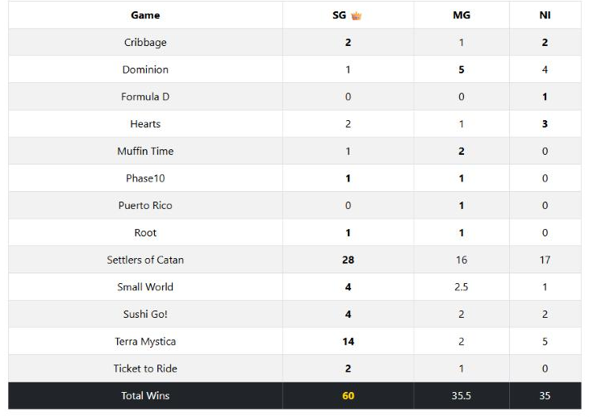

# The Scoreboard

A win tally for our game nights: who has won which game, overall totals, and how the race has changed over time.

**Live site:** https://master.d1uiq2n8l3hr2t.amplifyapp.com/



## Features

- **Table**: wins per game and player, with a Total Wins row. The overall leader gets a crown and gold total; the best score in each game is bold. Scores can include half points (from shared wins).
- **Trends**: each player's cumulative wins over time. Corrections (a win added then removed) don't show as dips.
- **Admin editing** (signed-in members of the Cognito `admin` group only):
  - **Edit scores** turns the table into −/+ steppers. Column order stays put while you edit; − asks for confirmation; every change shows a notice with **Undo**.
  - **Manage** card: add games and players, delete them from the roster, and browse the full score history, where any change can be voided.
  - Scores can never go below 0 (enforced by the server, not just the UI).

Anyone can view the board. Only admins can change it, and the backend enforces that on every write.

## Stack

- React 18, react-bootstrap 5, Recharts, built with Create React App (react-scripts 5) + CRACO
- AWS Amplify Gen 1: AppSync GraphQL API, DynamoDB, Cognito user pool (region `us-west-2`)
- Hosting: Amplify Hosting, built from `master`

## Data model

Defined in `amplify/backend/api/reactapp/schema.graphql`:

| Model | What it is |
|---|---|
| `Player` | A player's initials |
| `Game` | A game on the board |
| `GameScore` | One player's current score in one game (a table cell) |
| `ScoreEvent` | Append-only history: one row per score change. Rows are voided, never deleted. Powers Trends and the admin history. |

Score changes go through a custom `incrementScore` mutation that updates the cell atomically on the server and refuses to go below 0.

## Development

Requires Node 20 (see `.nvmrc`).

```
npm install
npm start                      # http://localhost:3000
npm test -- --watchAll=false   # run the tests once
npm run build                  # production build
```

The app reads its backend settings from `src/aws-exports.js`, which is generated and not committed. On a new machine:

```
npm install -g @aws-amplify/cli
amplify configure              # region us-west-2, profile "default"
amplify pull                   # connect to the existing backend
```

Never run `amplify init`: it creates a brand-new backend. Backend changes are deployed with `amplify push`.

## Ideas

- Links to each game's website
- A games-played count per game
- MFA for admin sign-in
- Move from Create React App to Vite
